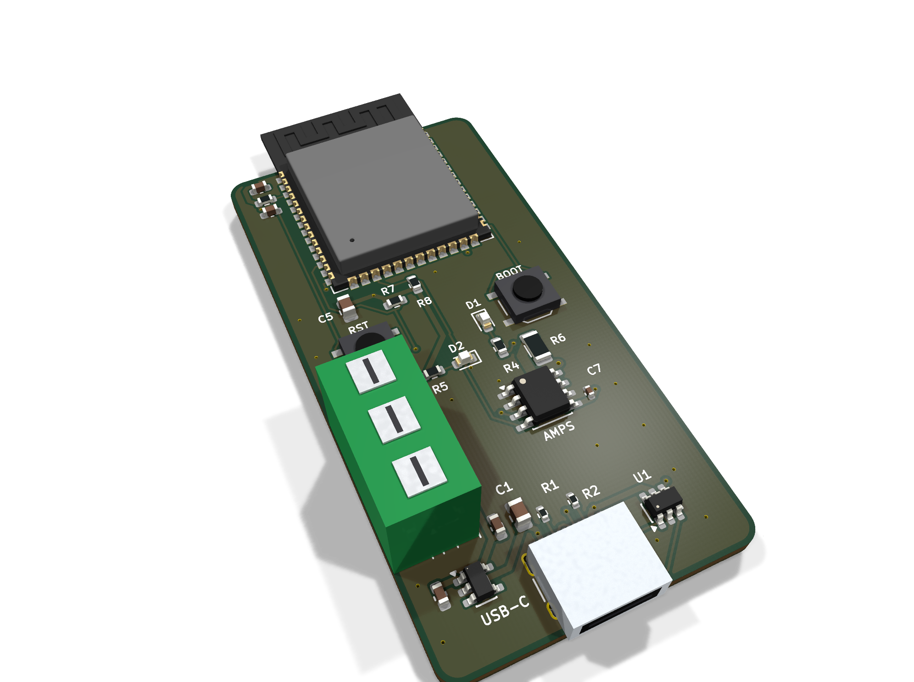

# S3 INA219

An ESP32-S3 board with TI INA219 load current and voltage monitor: USB-C, Wi-Fi and Bluetooth LE, ready to flash.

| Layers | Size | Parts | Nets | Connections routed | Vias | ERC errors | DRC errors / unconnected / parity |
|---|---|---|---|---|---|---|---|
| 4 | 30 x 60 mm | 25 | 16 | 72 -> 0 open | 35 | 0 | 0 / 0 / 0 |

**Not fabricated, assembled or powered.** Every number on this page is measured by KiCad 10 on the files in this folder; the full measurements are in [`report.json`](report.json).

| | |
|---|---|
| KiCad project | [`kicad/`](kicad/) |
| Gerbers, BOM, CPL, STEP, schematic PDF | [`fab/`](fab/) |
| Renders | [top](media/top.png), [bottom](media/bottom.png) |

A small ESP32-S3 development board built around one sensor: TI INA219 load current and voltage monitor. Plug in USB-C, flash it from Arduino, ESP-IDF or MicroPython over the ESP32-S3's native USB, and read the sensor. One of the HeyPCB ESP32 sensor series: the same ESP32-S3 template with a different sensor on each board. Designed with the HeyPCB method on KiCad 10, by heypcb-kicad's headless pipeline with Freerouting 2.4.1, from the brief in `board.json`.

## Specs

- **MCU:** ESP32-S3-WROOM-1-N16R8 (16 MB flash, 8 MB PSRAM, Wi-Fi + BLE 5), antenna over the top edge with no copper under it.
- **USB:** USB-C, native USB on the ESP32-S3 (no bridge chip), USBLC6-2 ESD clamp; BOOT (IO0) and RESET buttons.
- **Power:** USB 5 V to an AP2112K 3.3 V / 600 mA LDO; green power LED, blue user LED on IO48.
- **Sensor:** TI INA219 load current and voltage monitor. Wired to the ESP32-S3: I2C_SCL on IO9, I2C_SDA on IO8.
- **Board:** 30 x 60 mm, 4 layers (In1 GND plane), 1.6 mm.
- **Sensor notes:** INA219 (TI datasheet): A0 = A1 = GND gives address 0x40; bus voltage 0-26 V read on IN-; shunt range +-40 mV at the lowest gain = +-4 A on 10 mOhm, 10 uV (1 mA) per LSB; 100 nF on VS.
- **Sensor notes:** The load current runs supply + -> terminal pin 1 -> 10 mOhm 1 W shunt -> terminal pin 2 -> load +, with the supply and load ground on terminal pin 3 (shared with the board ground). Tracks on the load path are 1.0 mm: the board is made for up to 3 A, below the chip's full scale.

## Parts

Every line carries an LCSC part number. Stock is JLCPCB's assembly stock on 2026-10-18.

| Designators | Value | LCSC | MPN | JLCPCB tier | Stock |
|---|---|---|---|---|---|
| C1 | 10uF | C15850 | CL21A106KAYNNNE | Basic | 6,481,857 |
| C2,C3,C6 | 1uF | C15849 | CL10A105KB8NNNC | Basic | 9,242,432 |
| C4 | 100nF | C14663 | CC0603KRX7R9BB104 | Basic | 32,334,212 |
| C5 | 22uF | C45783 | CL21A226MAQNNNE | Basic | 3,755,608 |
| C7 | 100nF | C1525 | CL05B104KO5NNNC | Basic | 29,476,420 |
| D1 | Blue (IO48) | C84266 | NCD0603B1 | Extended | 226,365 |
| D2 | Green (PWR) | C12624 | KT-0603G | Extended | 499,725 |
| J1 | USB-C | C165948 | TYPE-C-31-M-12 | Extended | 357,307 |
| J2 | IN OUT GND | C5188435 | MX126-5.0-03P-GN01-Cu-S-A | Extended | 12,798 |
| R1,R2 | 5.1k | C25905 | 0402WGF5101TCE | Basic | 5,086,543 |
| R3 | 10k | C25804 | 0603WAF1002T5E | Basic | 39,931,112 |
| R4 | 1k | C21190 | 0603WAF1001T5E | Basic | 23,204,357 |
| R5 | 2.2k | C4190 | 0603WAF2201T5E | Basic | 6,534,948 |
| R6 | 10m | C105362 | FMF06FTHR010-LH | Extended | 145,279 |
| R7,R8 | 4.7k | C23162 | 0603WAF4701T5E | Basic | 18,613,172 |
| SW1 | BOOT | C318884 | TS-1187A-B-A-B | Basic | 290,976 |
| SW2 | RESET | C318884 | TS-1187A-B-A-B | Basic | 290,976 |
| U1 | USBLC6-2SC6 | C7519 | USBLC6-2SC6 | Extended | 33,518 |
| U2 | AP2112K-3.3 | C51118 | AP2112K-3.3TRG1 | Extended | 6,345 |
| U3 | ESP32-S3-WROOM-1-N16R8 | C2913202 | ESP32-S3-WROOM-1-N16R8 | Extended | 32,329 |
| U4 | INA219AIDR | C138706 | INA219AIDR | Extended | 7,458 |

## Ordering

- PCB: upload `fab/esp32_ina219_gerbers.zip`, 4 layers, 30 x 60 mm, 1.6 mm.
- Assembly: `fab/esp32_ina219_bom.csv` and `fab/esp32_ina219_cpl_jlc.csv`, top side.
- The CPL is fitted to each part's own JLCPCB footprint, pad by pad, and re-checked by laying each footprint where its row says: 23 of 25 rows fitted, worst pin-to-pad offset 0.20 mm.
- Not fitted (no JLCPCB footprint to fit to), rotation from KiCad's: SW1, SW2. Check these in JLCPCB's placement preview.

## Notes

- The two TS-1187A buttons are placed with KiCad's rotation: KiCad's footprint and JLCPCB's land share a frame (pads at x +-3.0, y +-1.85 mm), but the automatic fit cannot confirm it because KiCad numbers the pads 1, 1, 2, 2.
- The USB-C receptacle renders as a plain box: KiCad's footprint names a 3D model KiCad does not ship.
- Not built or measured.

## How it was made

Designed with the HeyPCB method on KiCad 10, by heypcb-kicad's headless pipeline with Freerouting 2.4.1, from the brief in [`board.json`](board.json).

## Licence

CERN-OHL-S-2.0, © 2026 heypcb.ai. See the collection's LICENSE.
